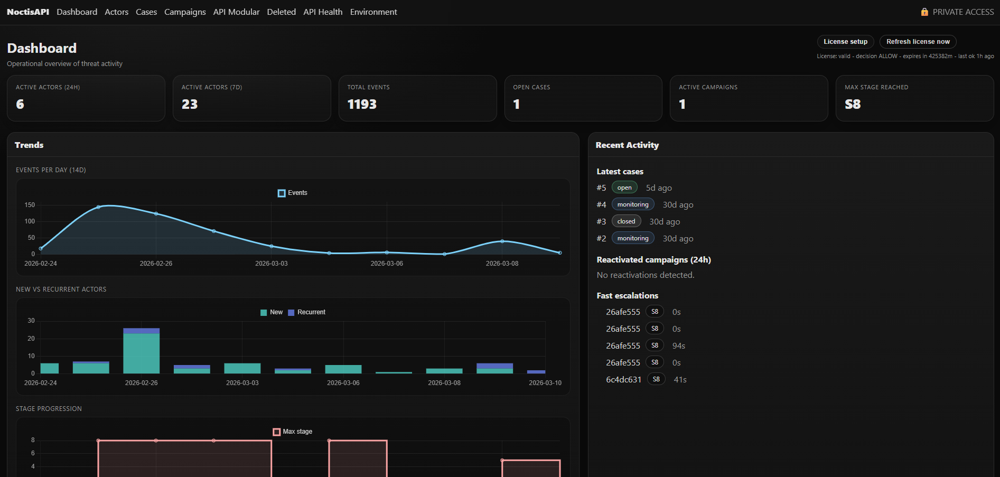
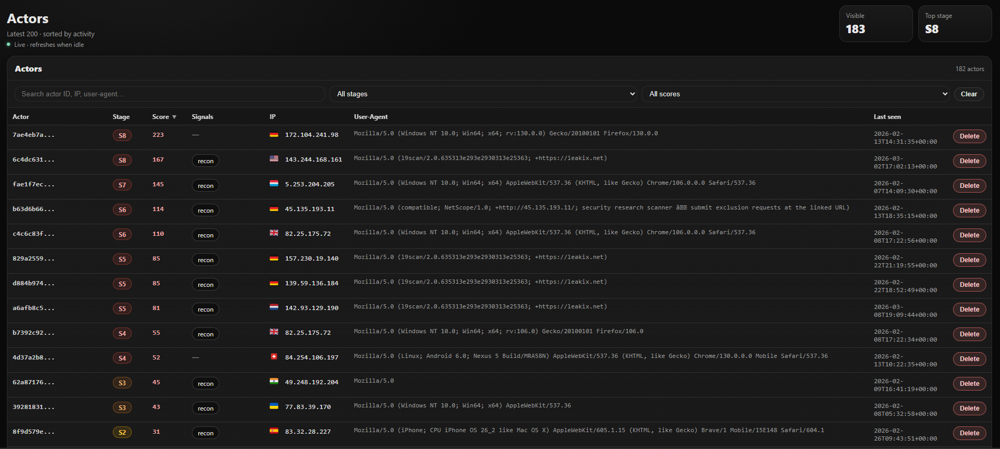
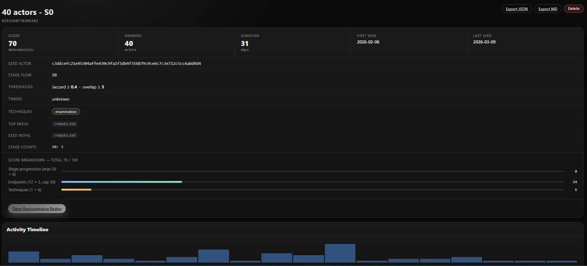
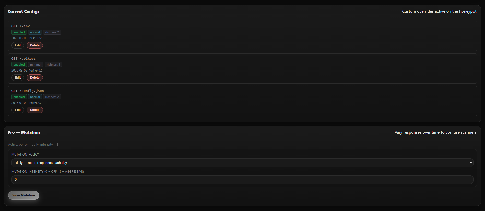

# NoctisAPI

**A honeypot API that looks real — and makes attackers believe it.**

Deploy a fake-but-convincing REST API surface. Every scanner, credential stuffer, and targeted attacker that hits it gets profiled, staged, and tracked. No agent. No code changes to your real infrastructure.

- One-command deploy with automatic TLS
- Actor profiling, session tracking, and behavioral scoring out of the box
- Open source Core — PRO unlocks investigations, campaigns, and smart deception

[](LICENSE)
&nbsp;
**[Quick Start](#quick-start)** · **[Core vs PRO](#core-vs-pro)** · **[Get PRO](https://noctisapi.com)**

---

## Preview

| Dashboard | Actors |
|---|---|
|  |  |

| Campaigns (PRO) | API Config |
|---|---|
|  |  |

---

## What is this?

Most honeypots are either too simple (attackers ignore them) or too complex to deploy. NoctisAPI is a production-grade deception layer built as a realistic REST API — it mimics the shape of real services so automated tools and human attackers engage with it.

What you get:

- A **convincing fake API** with staged responses, consistent fake data, and realistic error behavior
- An **admin panel** that tracks every actor, session, and interaction in real time
- **Behavioral profiling** that scores and stages attackers as they progress through your surface
- A **Docker-first deploy** — domain + email is all you need

You don't touch your real services. The honeypot sits alongside them.

---

## Core vs PRO

### Core — open source, always free

| Feature | |
|---|---|
| Realistic honeypot API surface | ✓ |
| Actor profiling + behavioral scoring | ✓ |
| Session tracking with stage progression | ✓ |
| Per-endpoint configuration (enabled, response mode, richness, status) | ✓ |
| Endpoint analytics + interest scoring | ✓ |
| API availability monitoring | ✓ |
| GeoIP enrichment via MaxMind GeoLite2 (optional) | ✓ |
| Bulk actor management (archive, delete, restore) | ✓ |
| Docker + Traefik with automatic TLS | ✓ |
| Webhook alerts | ✓ |

### PRO — paid license, offline verification

| Feature | |
|---|---|
| **Cases workflow** — triage attacker activity into structured investigations | ✓ |
| **Campaigns explorer** — cluster actors by behavior, visualize attacker campaigns | ✓ |
| **Replay & evidence** — link session replays and events to cases | ✓ |
| **Advanced scoring** — extended behavioral heuristics | ✓ |
| **File upload simulation** — capture attacker-supplied payloads safely | ✓ |
| **API Mutation** — rotate responses over time to confuse automated scanners | ✓ |
| **Smart Rules** — conditional per-endpoint overrides by path, method, or user-agent | ✓ |

> PRO features are verified by an offline license — no outbound calls to a backend. The instance falls back to Core mode if no valid license is present.

---

## Quick Start

### Core (open source)

```bash
bash setup.sh --domain api.example.com --email ops@example.com --yes
```

That's it. The script writes `.env.prod`, starts the stack, and issues a TLS certificate via Let's Encrypt.

### PRO

```bash
bash install.sh \
  --license /path/to/license.json \
  --domain  api.example.com \
  --email   ops@example.com \
  --yes
```

This also validates your license, downloads the Docker image, and installs everything in one pass.

**Requirements:** Docker 20.10+ with Compose plugin · `curl` · ports 80 and 443 open

---

## Manual Setup

If you prefer to configure things yourself:

```bash
cp .env.prod.example .env.prod
# Edit .env.prod — only 3 values are required:
#   HP_PUBLIC_HOST   your domain
#   ACME_EMAIL       Let's Encrypt email
#   HP_SEED          run: python -c "import secrets; print(secrets.token_hex(32))"

docker compose --env-file .env.prod -f compose/docker-compose.prod.yml up -d
```

---

## How It Works

NoctisAPI runs as two services sharing a single SQLite database:

```
Internet
    │
    ▼
Traefik :443  (TLS termination)
    │
    ├─▶  Public API    :8000  ← attacker-facing, mimics a real REST API
    │    (honeypot_public.py)
    │
    └─▶  Admin Panel   :9001  ← internal only, SSH tunnel
         (panel_mvp.py)
              │
              └─▶  SQLite (WAL)  /data/honeypot.db
```

The public API surface is fully synthetic. It returns consistent fake data, progresses attackers through stages (recon → credential stuffing → exploitation), and captures rich telemetry without ever executing anything.

The admin panel is never exposed to the internet — access it via SSH tunnel from your local machine.

---

## Admin Panel Access

```bash
# From your local machine:
ssh -L 9001:127.0.0.1:9001 user@your-server

# Then open:
http://localhost:9001
```

---

## Upgrade to PRO

PRO unlocks the full investigation and deception toolkit: Cases, Campaigns, Replay, Smart Rules, API Mutation, and the file upload pipeline.

**Get a license** at [noctisapi.com](https://noctisapi.com).

**Activate on an existing Core install:**

```bash
# Option A — admin panel UI: Settings → License → Upload license.json

# Option B — place the file directly:
docker cp license.json <container>:/var/lib/myapp/license.json
docker compose restart app admin
```

**Check license status:**

```bash
# In the admin panel:
# Settings → License

# Or via CLI:
docker exec <app-container> python scripts/print_licensing_identity.py
```

PRO runs entirely offline. No license server calls after activation.

---

## Configuration

Most settings have sensible defaults. The minimum required to deploy:

| Variable | Required | Description |
|---|---|---|
| `HP_PUBLIC_HOST` | Yes | Your public domain (e.g. `api.example.com`) |
| `ACME_EMAIL` | Yes | Email for Let's Encrypt TLS |
| `HP_SEED` | Yes | Stable random secret — auto-generated by installer |
| `DATABASE_URL` | Yes | SQLite path for Alembic migrations (default in example) |
| `HP_ENFORCE_LICENSE` | PRO only | Set to `1` to enforce PRO mode |

> **`HP_SEED` must never change after first run.** It derives all actor IDs — changing it invalidates your entire history.

Common optional settings:

| Variable | Description |
|---|---|
| `HP_DEPLOYMENT_ID` | Label for this instance (useful with multiple deploys) |
| `MAXMIND_ACCOUNT_ID` + `MAXMIND_LICENSE_KEY` | Enable GeoIP enrichment (free MaxMind account) |
| `HP_ALERT_WEBHOOK_URL` | Slack/Discord webhook for high-signal alerts |
| `HP_ACTOR_UA_MODE` | Actor identity mode: `ip` (default) · `family` · `full` |
| `LOG_LEVEL` | `debug` · `info` (default) · `warning` |

See [`.env.prod.example`](.env.prod.example) for all options with descriptions.

---

## Usage

Once deployed, the honeypot serves on your domain. Point attackers at it by registering the domain, including it in public DNS, or letting search engine crawlers find it.

The admin panel shows activity as it happens:

- **Dashboard** — live hit counts, active actors, top endpoints
- **Actors** — per-actor profiles with stage, score, sessions, and IP/geo
- **Sessions** — multi-step interactions with full event timeline
- **Endpoints** — interest scores and hit patterns per API path
- **Campaigns** (PRO) — behavioral clusters across actors
- **Cases** (PRO) — triage queue for investigation

**Export data:**

```bash
# Full actor export (CSV):
GET /admin/actors/export

# Sessions export:
GET /admin/sessions/export
```

**Bulk operations** are available in the Actors view — select actors and archive, delete, or merge in bulk.

---

## Local Development

```bash
# Start with hot reload:
docker compose -f compose/docker-compose.dev.yml up -d

# API:   http://localhost:8000
# Admin: http://localhost:9001

# Logs:
docker compose -f compose/docker-compose.dev.yml logs -f

# Migrations:
make db-upgrade

# Stop:
docker compose -f compose/docker-compose.dev.yml down
```

---

## Maintenance

**Backups:**

```bash
# One-off backup (writes to ./backups/):
bash backup_sqlite.sh

# Enable daily automated backups:
cp ops/cron/yourapp-backup /etc/cron.d/yourapp-backup
# Edit the file to set your paths
```

**Data retention** (prune old rows, runs automatically via cron):

```bash
# Dry run:
docker exec <app-container> python scripts/prune_retention.py --db /data/honeypot.db --dry-run

# Apply:
docker exec <app-container> python scripts/prune_retention.py --db /data/honeypot.db
```

Defaults: events 30d · sessions 30d · tokens 90d · jobs 30d. Override via env vars (e.g. `HP_RETENTION_EVENTS_DAYS=60`).

**Updates:**

```bash
# Pull latest image and restart:
docker compose --env-file .env.prod -f compose/docker-compose.prod.yml pull
docker compose --env-file .env.prod -f compose/docker-compose.prod.yml up -d
```

---

## FAQ

**Does it call home? Does the PRO license require internet access?**
No. PRO license verification is entirely offline using a signed document and a bundled public key. No outbound calls are made for licensing.

**What happens if my PRO license expires?**
The instance automatically falls back to Core mode. No data is lost. PRO features are disabled until the license is renewed.

**Can I run multiple instances with one license?**
Depends on your license. Each instance has a unique fingerprint derived from the host machine ID. Check your license terms.

**How do I keep the host fingerprint stable across container rebuilds?**
The prod compose mounts `/etc/machine-id` from the host into the container. This is the default behavior — no action needed.

**Will attackers know it's a honeypot?**
The public API mimics real service behavior with staged responses, consistent fake data, and realistic error codes. There is no indication it is a honeypot in any response. What it returns depends on how you configure it.

**Can I use it without Traefik / without a public domain?**
Yes — for internal use or testing, run the dev compose which doesn't require Traefik or TLS. For production, Traefik is recommended for automatic certificate management.

**The Core is Apache-2.0 — can I self-host and modify it?**
Yes. The Core source is at [github.com/noctisapi/noctisapi-core](https://github.com/noctisapi/noctisapi-core) under Apache-2.0.

---

## Contributing

Bug reports and pull requests for the Core are welcome at [github.com/noctisapi/noctisapi-core](https://github.com/noctisapi/noctisapi-core).

For issues specific to a PRO deployment, open a ticket via [noctisapi.com](https://noctisapi.com).

---

## License

[Apache-2.0](LICENSE) — Core
PRO features require a separate paid license. See [noctisapi.com](https://noctisapi.com).
